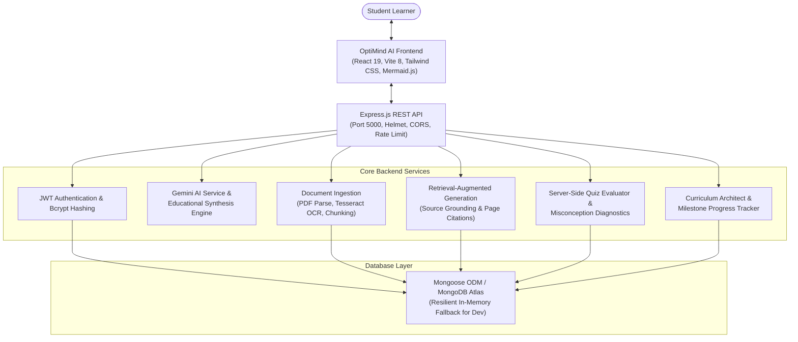

# OptiMind AI

> **"See It, Understand It, Master It."**

OptiMind AI is a production-oriented, AI-powered visual educational platform designed for students, self-learners, and lifelong learners. It transforms dense course notes, complex algorithms, mathematical theorems, and technical concepts into interactive step-by-step visual models, document-grounded answers (RAG) with verified page citations, browser-narrated lessons, adaptive diagnostic assessments, and personalized study roadmaps.

---

## System Architecture



---

## Core Implemented Modules

### 1. AI Concept Understanding (`/dashboard/explainer`)
- Deconstructs any challenging technical topic or question.
- Configurable domain areas: Computer Science, Algorithms, Mathematics, Networking, Physics, General Engineering.
- Multi-tier depth levels (Beginner, Intermediate, Advanced) and pedagogical structures (Step-by-step, Summary, Mental Analogy).
- Powered by Google Gemini API with transparent, high-yield educational synthesis fallback when offline or unkeyed.
- Save explanations to workspace and clipboard export.

### 2. Visual Learning Engine & Mermaid.js Studio (`/dashboard/visuals`)
- Step-by-step algorithmic and structural state progression.
- Pre-built interactive algorithm presets:
  - **Binary Search**: Dynamic logarithmic midpoint elimination, sorted memory buffer pointers.
  - **Bubble Sort**: Monotonic inversion resolution, adjacent comparisons, boundary locking.
  - **Linked List**: Dynamic heap pointer allocation, head reference repointing.
- **Custom AI Visual Generator**: Generates custom multi-stage visual lessons with valid Mermaid.js diagrams for any arbitrary concept (e.g. Dijkstra, Paxos, QuickSort).
- Integrated with browser speech synthesis narration.

### 3. Accessible Audio Narration (Web Speech API)
- Converts lesson steps and explanations to audible speech.
- Play, pause, resume, and stop controls.
- Speech rate configuration and voice selection.
- Synchronized with active visual lesson steps.

### 4. Document Processing & Computer Vision OCR (`/dashboard/documents`)
- Multi-format file ingestion: **PDF**, **TXT**, **PNG**, **JPG**, **JPEG** (up to 15MB).
- Server-side PDF extraction via `pdf-parse`.
- Optical Character Recognition (OCR) for printed textbook photos and scans via pure WASM `tesseract.js` (no native binary dependencies required).
- Semantic sliding-window chunking with preserved document and page/section metadata.
- Safe file upload handling, extension validation, unique file IDs, and ownership isolation.

### 5. Grounded RAG Assistant (`/dashboard/documents`)
- Genuine Retrieval-Augmented Generation (RAG).
- Queries user's private indexed material with term proximity and relevance scoring.
- Grounded answer generation strictly citing real source documents and page numbers.
- Explicit notification when evidence in uploaded materials is insufficient to prevent hallucination.
- Document ownership enforcement: users can only query their own materials.

### 6. Adaptive Quiz Generation & Server-Side Evaluation (`/dashboard/quizzes`)
- Generates 3-4 diagnostic multiple-choice questions from topic or uploaded documents.
- Correct answers remain secret on the server and are strictly omitted from client responses prior to submission.
- Server-side scoring prevents score tampering.
- Post-submission explanation of correct choices, identification of misconceptions, and targeted revision recommendations.
- Quiz attempt history persisted per user.

### 7. Personalized Learning Roadmaps (`/dashboard/roadmap`)
- Structured study planning based on goal, domain, skill level, available hours/week, and target duration.
- Sequenced milestone checklist with estimated study hours and topic lists.
- Interactive milestone toggling (`PATCH /api/roadmaps/:id/milestones/:milestoneId`) with real-time overall progress recalculation.

### 8. Learning Progress & Telemetry (`/dashboard/progress`)
- Real telemetry derived strictly from measured user activity.
- Tracks verified study time, active learning streak, average assessment score, and completed roadmap milestones.
- Automatic aggregation of diagnosed weak areas with direct one-click revision paths.

---

## Project Structure

```
optimind-ai-single/
├── backend/
│   ├── src/
│   │   ├── config/          # Environment configuration (env.js) & DB connection (db.js)
│   │   ├── controllers/     # Modular route controllers (auth, ai, document, rag, quiz, roadmap, progress)
│   │   ├── middleware/      # Auth (JWT), Upload (Multer), Logger, ErrorHandler
│   │   ├── models/          # Mongoose models & store abstraction (User, Document, Quiz, Roadmap, etc.)
│   │   ├── routes/          # Express route definitions
│   │   ├── services/        # AI (Gemini), Document/OCR, RAG, Quiz, Roadmap services
│   │   ├── utils/           # Async handler, JWT helper
│   │   ├── app.js           # Express app setup (Helmet, CORS, Rate Limit)
│   │   └── server.js        # Server listener and graceful shutdown
│   ├── tests/               # Node test runner suite (10 unit & integration tests)
│   ├── .env.example         # Backend environment template
│   └── package.json
├── frontend/
│   ├── src/
│   │   ├── components/      # Common UI components, layout, visualizer, MermaidDiagram
│   │   ├── context/         # AuthContext (login, register, guest mode, token persistence)
│   │   ├── pages/           # Landing, Login, Register, Dashboard, Explainer, Visuals, Documents, Quizzes, Roadmap, Progress
│   │   ├── services/        # API client (api.ts) with auth headers
│   │   ├── types/           # TypeScript domain definitions
│   │   └── utils/           # Speech synthesis, styling utilities
│   ├── verify-e2e.mjs       # Headless Puppeteer E2E verification test
│   ├── .env.example         # Frontend environment template
│   ├── vercel.json          # Vercel deployment routing configuration
│   └── package.json
├── render.yaml              # Render production deployment blueprint
├── .gitignore
└── README.md
```

---

## How to Run Locally (Windows PowerShell)

### Prerequisites
- Node.js (v20+ recommended; verified on Node v24.20.0)
- npm (v10+ recommended; verified on npm 11.19.0)

### 1. Backend Setup
Open a PowerShell terminal:

```powershell
cd backend
npm.cmd install
```

Copy the environment template:
```powershell
Copy-Item .env.example .env
```

*(Optional: Insert your `GEMINI_API_KEY` from Google AI Studio and `MONGODB_URI` from MongoDB Atlas into `backend/.env`. If omitted, the server automatically runs in resilient in-memory mode and educational synthesis mode).*

Run the test suite:
```powershell
npm.cmd test
```

Start the backend server:
```powershell
npm.cmd run dev
# or: node src/server.js
```
The backend starts on `http://localhost:5000`. Health check is available at `http://localhost:5000/api/health`.

---

### 2. Frontend Setup
Open a second PowerShell terminal:

```powershell
cd frontend
npm.cmd install
```

Verify production build:
```powershell
npm.cmd run build
```

Start the development server:
```powershell
npm.cmd run dev
```
Open your browser at `http://localhost:5174` (or `http://localhost:5173`).

---

### 3. Run End-to-End Verification
With both backend (port 5000) and frontend (port 5174) running:

```powershell
cd frontend
node verify-e2e.mjs
```

---

## Production Deployment Guide

### Option A: 1-Click Deployment on Render
1. Push this repository to GitHub or GitLab.
2. In Render Dashboard, click **New > Blueprint** and select your repository (`render.yaml`).
3. Render automatically provisions:
   - **optimind-ai-backend**: Node web service running `node src/server.js`.
   - **optimind-ai-frontend**: Static site serving `dist/` with SPA rewrite rules.
4. Set the environment variables in the Render dashboard:
   - `MONGODB_URI`: Your MongoDB Atlas connection string.
   - `GEMINI_API_KEY`: Your Google Gemini API key.
   - `FRONTEND_URL`: URL of the deployed frontend static site.
   - In frontend: `VITE_API_BASE_URL`: URL of the deployed backend service (e.g. `https://optimind-api.onrender.com/api`).

### Option B: Frontend on Vercel & Backend on Render / Railway
1. **Frontend on Vercel**:
   - Import `frontend` directory.
   - Framework preset: Vite.
   - Build command: `npm run build`.
   - Output directory: `dist`.
   - Set environment variable `VITE_API_BASE_URL` to `https://your-backend.domain.com/api`.
   - `frontend/vercel.json` automatically handles SPA client-side routes.
2. **Backend**:
   - Deploy `backend` to any Node.js host (Render, Railway, Fly.io).
   - Set `FRONTEND_URL` to your Vercel deployment domain.

---

## Truth-in-Product Standard

- **No Artificial Customer Claims**: OptiMind AI does not display fake testimonials or fabricated user counts.
- **No Client-Side Score Tampering**: Quiz scores and answers are calculated strictly on the backend.
- **Transparent Service Reporting**: The health endpoint (`/api/health`) truthfully discloses whether MongoDB and Gemini API keys are connected or running in local offline fallback mode.
